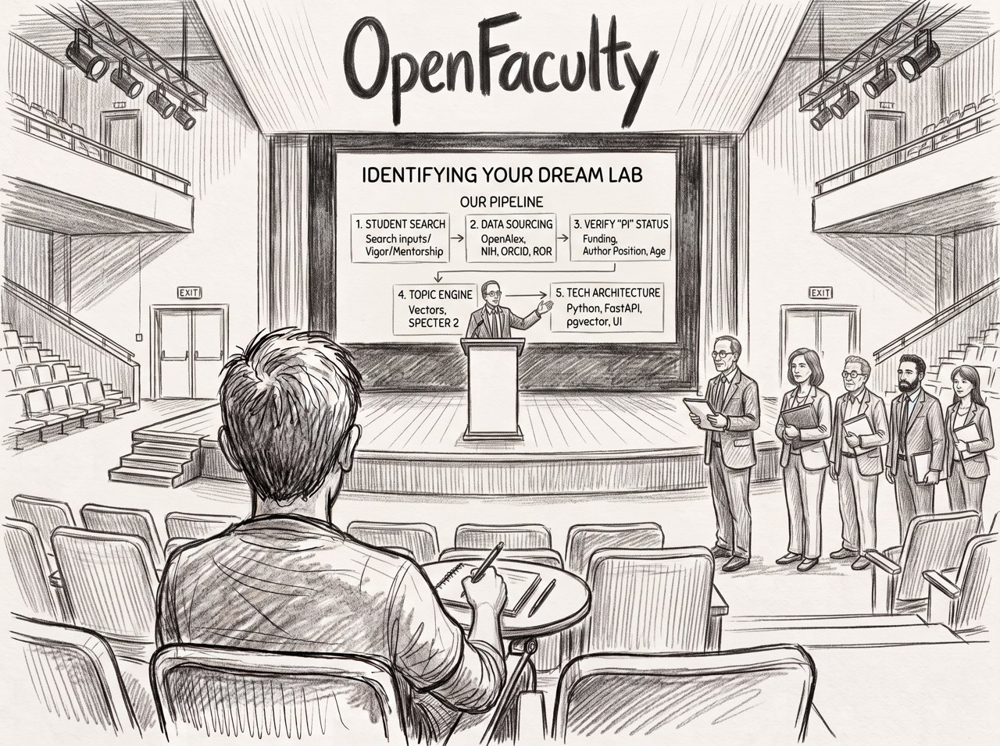

<div align="center">
  
</div>

# OpenFaculty

Finding a lab can be frustrating. Find the corresponding author, go to their faculty page, read more into their work, see if they have a grant. Hours of work. OpenFaculty puts you in charge: find funded graduate labs to reach out to in no time!

And it is worse than hours, because the work does not accumulate. You open a paper you liked, scroll to the bottom for the corresponding author, and already you are guessing: the last author is *usually* the PI, but not always. Their affiliation is printed as it was two years ago. You search the university site, find a faculty page that may or may not still exist, and the email on it may or may not still work. Then you want to know whether the lab actually has money, which is a different website entirely. Five tabs for **one** lab, and at the end of it you still do not know whether they can take a student.

Twenty labs later you have a browser full of dead faculty pages and no list.

**OpenFaculty does that comb for you, from the open scholarly record.** It starts from a research topic, finds the people publishing on it, works out which of them run labs, checks whether those labs hold active federal funding, and resolves each one to a current faculty page and contact address. You get a ranked shortlist in your terminal, out of a database on your own machine.

```
  28 people who are FUNDED, PUBLISHING and CONTACTABLE

  [4] SURNAME, FIRSTNAME     (State University, CA)
     name@university.edu
     funded FY2024 · 8 papers since 2020 · matched on california, francisco
     grant: Genetic and Proteomic Approaches to Reveal Bacterial Vulnerabilities
     paper: Bacteriophage genome engineering with CRISPR-Cas13a. (2022)
```

*(Real output, with the names removed. These are real people, so this README does not print any of them.)*

---

## Install

```bash
pip install git+https://github.com/JWWHaymar/OpenFaculty.git
openfaculty quickstart
```

**No dependencies.** Standard library only: `urllib`, `sqlite3`, `json`, `re`. There is no wheel that can fail to build, no API key to register for, no account, and no server. Every source it reads is a free public API.

Declared as Python 3.10+; **tested on 3.12 and 3.14**, each in a fresh virtualenv running the full pipeline against the live APIs. If you run it on 3.10 or 3.11 and something breaks, that is a bug worth an issue, because nobody has put those two through it.

---

## The five commands

```bash
openfaculty people --collect          # ① who publishes on this
openfaculty people --backfill-emails  #    get their addresses
openfaculty grants --collect          # ② who holds NIH money
openfaculty nsf --collect             #    who holds NSF money
openfaculty faculty                   # ③ resolve the rest to a faculty page
openfaculty outreach --write          # ④ the shortlist, as a file you keep
```

Each stage writes to the same local SQLite database, so you can stop after any one and look at what it found. Searching your own field instead of the built-in one is `--topic`:

```bash
openfaculty people --collect --topic "chromatin remodeling cancer"
```

### How it fits together

```
                    you type a research topic
                              │
   ① PEOPLE                   ▼
   people.py        Europe PMC  ──▶  papers on that topic
                    last author ──▶  probably the PI
                    ORCID       ──▶  which "J. Smith" is it?
                              │
   ② MONEY                    ▼
   grants.py        NIH RePORTER ──▶ human health
   nsf.py           NSF BIO/OCE  ──▶ ecology, marine, evolution
                    is there live money in this lab?
                              │
   ③ FIND THEM                ▼
   faculty.py       institution ──▶ current faculty page
                    robots.txt respected, rate limited per host
                    refuses rather than guessing
                              │
   ④ SHORTLIST                ▼
   outreach.py      FUNDED ∧ PUBLISHING ∧ CONTACTABLE
                    ranked · your dismissals stick
                              │
                              ▼
                    openfaculty.db — local SQLite
                    no server, no account, no upload
```

---

## Scope, stated up front

**OpenFaculty was built for life-sciences lab search, and the judgement layer is specific to that.** This is the honest boundary, and it is better to know it before you clone than after:

| Layer | Generalises? |
|---|---|
| **Retrieval** — resolve a researcher, find their institution and faculty page | **Yes.** Nothing in it is biology-specific |
| **Funding signal** — active grants as a proxy for a lab that can take people | **Partly.** NIH RePORTER (biomedical) and NSF (BIO/OCE, so marine and environmental microbiology too). Both US federal; no international funders |
| **Topic and fit scoring** — is this lab actually doing the work you care about | **No.** The concept vocabulary is hand-written for microbiology and phage biology |

So a molecular microbiologist can use this today, and so can a marine microbial ecologist. A civil engineer cannot, because the concept vocabulary knows nothing about that field and NSF's engineering directorates are not wired in. Replacing the hand-written topic layer with a general one is a rewrite of the hardest module rather than a configuration flag, and pretending otherwise would waste your time.

**What generalises is the part most tools get wrong anyway:** taking a name on a paper and reliably landing on the right person's current page.

---

## What it refuses to do

**It cannot send email, and that is enforced by a test rather than by a promise.**

```bash
$ openfaculty test
PASS: 8 modules checked, none can send mail.
      The tool prepares; you send.
```

The distance between *printing an address* and *mailing 300 addresses* is about four lines of `smtplib`, and whoever writes those four lines will have a good reason at the time. **A bad first email to a lab cannot be retracted, and you get one first contact per lab.** So `test_cannot_send.py` fails the build if any module imports a mail library or mentions a mail transport, even in a string.

It also refuses in smaller ways, all of them deliberate:

- **An empty result is reported as an error, not as a finding.** If a public index returns nothing for a phrase that should match, the query is broken, not the field empty.
- **A faculty page listing forty people yields nothing.** An address is accepted only when the local part looks like the person, it is not a department office, it is the only candidate on the page, and the page's prose names them. `looked-and-refused` and `could-not-look` are counted separately, because they are different facts.
- **Your dismissals stick, and are shown rather than silently applied.** A list that has quietly dropped people is a list whose length means nothing.

---

## Where it can still be wrong

A tool that cannot tell you its own failure modes is asking you to trust it, which is worse than useful.

**The join is on a name, and a name is a bad key.** NIH RePORTER writes `STEVENSON, BRIAN`. Europe PMC writes `Yamaki S`. No source publishes an identifier the others use, so surname plus first initial is the most specific identity they actually agree on. Measured: that alone produced 463 "matches", a large fraction of them two different scientists glued together.

Two independent checks defend it, and **both were needed**:

1. **The institution must agree** between the grant and the paper.
2. **The email must be plausibly US**, because a US federal grant does not come with a `.cn` address.

Institution agreement alone still passed *Caltech ~ Tianjin University of Technology* on the word **technology**, and *Salk ~ Nankai* on **studies**. Found by reading the output, not by a test. Generic institution words are now stripped before matching.

**What can still slip through:** two scientists with the same surname and initial at the *same* institution would merge. Check the name against the grant title before you write to anyone. `--audit` shows you every match that was rejected and why.

**One surname can reach more than one person.** If you dismiss `Wang, T`, the shortlist tells you in writing when that key also covers a different Wang, because you cannot consent to a side effect you cannot see.

---

## How it's built

Nine modules, about 5,600 lines, no dependencies. The six that carry the judgement are below; `config.py`, `store.py` and `cli.py` are plumbing. The interesting parts are the places where it says no.

| Module | What it owns |
|---|---|
| `people.py` | Europe PMC search, last-author extraction, ORCID disambiguation, address backfill from open-access full text |
| `grants.py` | NIH RePORTER. Why `phage` beats `bacteriophage` as a query (456 projects against 278) |
| `nsf.py` | NSF awards. The ecology and evolution half of the field that NIH does not fund and therefore cannot see |
| `faculty.py` | The polite web fetcher: `robots.txt`, per-host rate limiting, an on-disk cache, and the refusal logic |
| `concepts.py` | What the words *mean*. Composition, sense, and the disqualifiers |
| `matching.py` | Deciding whether two records name the same person. Everything here refuses rather than guesses |

**`concepts.py` is the part worth reading.** A keyword list is spelling, not understanding, and three measured failures are encoded there:

- **An acronym is not its members.** A term list contained the literal string `eskape`, which appears **zero** times across 831 real texts. What appears is *Klebsiella pneumoniae*, *Acinetobacter baumannii*. Naming a member now counts as naming the group.
- **A macrophage is not a bacteriophage.** `-phage` is Greek for "eater" and names two unrelated things. `\bphage\b` looks safe until a PDF wraps the word across a line: *macrophage* arrives as `macro- phage`, which contains a genuine word boundary. 54 abstracts had that shape, and one put a radiation-immunology grant into the top tier of phage labs. The fix is an allowlist of virological prefixes, not a blocklist of cell types, because a blocklist fails on the next prefix nobody listed.
- **The same word means different work in different contexts.** *Phage display* and *PhIP-Seq* contain "phage" and are antibody methods. They are not suppressed, they are re-labelled as their own concept, because a text can be genuinely about phage display while not being about phage biology at all.

Every relevance claim carries the phrase that triggered it. A score with no quote behind it is what once matched `rag` inside "b-**rag**-nd new lab space" and reported a retrieval-augmented-generation lab.

---

## Being a good citizen

Every request identifies itself:

```
OpenFaculty/1.0 (one researcher looking up faculty contact pages;
                 respects robots.txt; +https://github.com/JWWHaymar/OpenFaculty)
```

`faculty.py` **parses `robots.txt` before fetching**, waits between requests to the same host, caches every fetch so a second run costs nothing, and never follows a link off the host it started on. There is no spoofed browser string anywhere in the codebase: every source it queries is a public API that wants to know who is calling, and spoofing Chrome at NIH RePORTER would buy nothing while making this paragraph false.

**If you fork this, point that URL at your fork** (`OPENFACULTY_AGENT_URL`). The entire purpose of the `+url` convention is to give an annoyed sysadmin somewhere to look, and leaving it pointed here attributes your traffic to somebody who cannot answer for it.

---

## Data sources, and your responsibility

OpenFaculty is a client. It ships no data and stores nothing on a server: results go to a local SQLite database on your machine. The code is MIT licensed; **the data it retrieves is not covered by that license**, and each source sets its own terms.

| Source | What it provides | Terms |
|---|---|---|
| [NIH RePORTER](https://api.reporter.nih.gov) | federally funded grants | US government data, generally public domain; see NIH's API terms |
| [NSF Award Search](https://www.research.gov) | federally funded grants | US government data; see NSF's terms |
| [Europe PMC](https://europepmc.org) | publications and abstracts | per-record licence; abstracts vary by publisher |
| [ORCID](https://orcid.org) | author identity and affiliation | public records only, per each researcher's own privacy settings |
| University faculty pages | contact details | **each institution's terms, and its `robots.txt`** |

**You are responsible for the terms of the sources you query**, and for what you do with what comes back. In particular:

- **Contact details belong to real people.** This exists to help you write *one considered email to a lab whose work you have read*. It is not a mailing-list builder, and using it as one is both rude and likely a breach of the terms above.
- **Respect the crawl rules.** Do not patch out the `robots.txt` check.
- **Bulk scraping is out of scope.** This looks up labs you have a reason to look up.

Nothing here is legal advice.

---

## Why this exists

I built it while looking for a PhD lab, because doing it by hand was taking weeks and the work never accumulated: every lab was five tabs from scratch.

It is also, honestly, a record of being wrong in public. Almost every refusal in this codebase is there because an earlier version produced a confident wrong answer and I read the output closely enough to catch it: the address that belonged to a first author rather than the PI, the radiation-immunology grant ranked as phage work, the 23 funded PIs that vanished because two modules disagreed about where a surname ended, the NSF collector that died on the first co-funded award because one JSON field is sometimes a list. None of those were found by a test. They were found by reading what the program said and not believing it.

**So the tool ranks; it does not decide.** You know your own field, and you will know within ten names whether the ordering is sane. The list is a starting point for reading, not a score to trust.

---

## License

MIT. See [LICENSE](LICENSE).

Built by [JWW Haymar](https://jwwhaymar.github.io/), with an AI agent as a working partner rather than a ghostwriter. The measurements quoted throughout are real, and were taken from live runs against the APIs named above.
